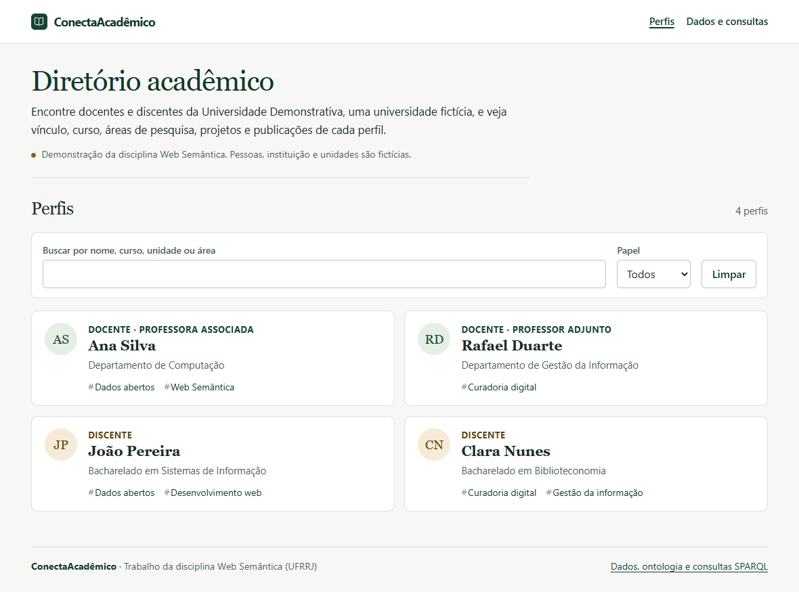
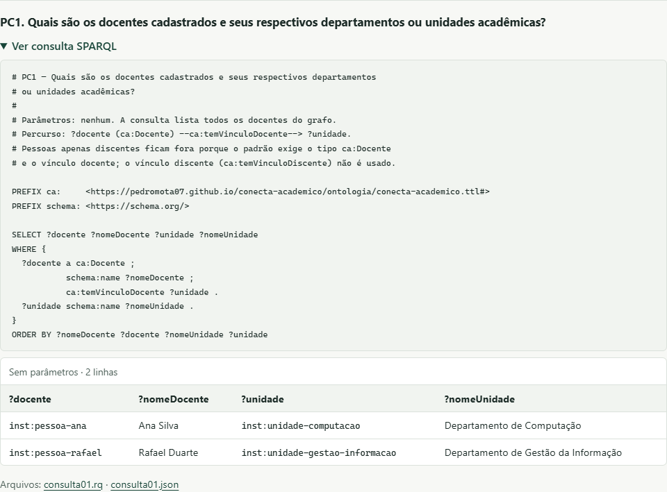

# ConectaAcadêmico

Diretório semântico de perfis universitários. O catálogo reúne docentes e discentes fictícios e relaciona seus vínculos, cursos, áreas de pesquisa, projetos e publicações em um grafo RDF.

**[Acessar a aplicação](https://pedromota07.github.io/conecta-academico/)**



## O que você pode explorar

- Buscar perfis por nome, curso, unidade ou área e filtrar por papel acadêmico.
- Abrir o perfil de cada pessoa e consultar formação, vínculos e produção acadêmica.
- Explorar a ontologia, os dados RDF e os resultados de seis consultas SPARQL, além de ligações de áreas de conhecimento ao Wikidata.

A página [Dados e consultas](https://pedromota07.github.io/conecta-academico/dados.html) exibe os resultados gerados com RDFLib. As consultas podem ser reproduzidas localmente.



## Tecnologias e execução

Os perfis têm uma fonte comum em [JSON](exemplos/perfis/dados.json). **Python** gera o site estático em **HTML e CSS**, com **JavaScript** para busca e filtros. **RDFLib** gera os dados em Turtle e executa as consultas **SPARQL** sobre a ontologia **OWL** e o grafo de instâncias.

Com Python 3.10 ou superior, sirva o site já gerado a partir da raiz do repositório.

```powershell
python -m http.server 8000 --bind 127.0.0.1 --directory docs
```

Abra a [prévia local](http://127.0.0.1:8000/). Para regenerar o site, executar as consultas com outros parâmetros ou rodar os testes, siga o [guia de execução local](documentacao/execucao-local.md).

## Documentação

- [Ontologia OWL](ontologia/conecta-academico.ttl), [instâncias RDF](ontologia/instancias.ttl) e [modelo de dados](documentacao/ontologia-aplicacao.md).
- [Consultas SPARQL](consultas/), [resultados](consultas/resultados/README.md) e [ligações ao Wikidata](documentacao/ligacoes-externas.md).
- [Requisitos da disciplina](proposta/requisitos.md), [modelo conceitual](documentacao/decisoes-modelagem.md) e [declaração de uso de IA](documentacao/uso-ia.md).

## Créditos e licença

Trabalho final da disciplina Web Semântica da Universidade Federal Rural do Rio de Janeiro (UFRRJ), ministrada pelo professor Tiago Cruz de França. A apresentação partiu dos modelos HTML e CSS fornecidos pelo professor.

**Integrantes** · Pedro Mota, Hugo Kauã e Caio Luiz.

O conjunto de dados fictícios é licenciado sob [Creative Commons Atribuição 4.0 Internacional (CC BY 4.0)](https://creativecommons.org/licenses/by/4.0/).
